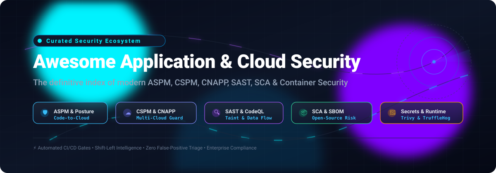

# 🛡️ Awesome Application & Cloud Security

<p align="center">
  
</p>

<p align="center">
  <a href="https://github.com/ishandutta2007/Awesome-Awesome-Awesome"></a><a href="https://discord.gg/jc4xtF58Ve"></a>
  <a href="https://github.com/ishandutta2007/Awesome-Application-Cloud-Security/stargazers"></a>
  <a href="https://github.com/ishandutta2007/Awesome-Application-Cloud-Security/network/members"></a>
  <a href="https://github.com/ishandutta2007/Awesome-Application-Cloud-Security/issues"></a>
  <a href="https://github.com/ishandutta2007/Awesome-Application-Cloud-Security/blob/main/LICENSE"></a>
  <a href="https://github.com/ishandutta2007"></a>
</p>

---

> **An authoritative, community-curated directory of Application Security Posture Management (ASPM), Cloud Security Posture Management (CSPM), Cloud-Native Application Protection Platforms (CNAPP), SAST, DAST, SCA, Secrets Detection, and Container Security solutions.** 🌟 Star if you find it helpful! 🌟

**Last updated:** October 2026 • **Maintained by:** [@ishandutta2007](https://github.com/ishandutta2007)

---

## 📑 Table of Contents

- [🌐 Sector Overview & Market Dynamics](#-sector-overview--market-dynamics)
- [🏢 SaaS & Hosted Commercial Platforms](#-saas--hosted-commercial-platforms)
- [💻 Open-Source Security Tools & Platforms](#-open-source-security-tools--platforms)
  - [Top Open-Source Projects (Ranked by GitHub_Stars)](#top-open-source-projects-ranked-by-github-stars)
  - [Architectural Roles & Open-Source AppSec Stacks](#architectural-roles--open-source-appsec-stacks)
- [🤝 How to Contribute](#-how-to-contribute)
- [💖 Support & Sponsorship](#-support--sponsorship)
- [📈 Star History](#-star-history)
- [⚠️ Disclaimer](#️-disclaimer)

---

## 🌐 Sector Overview & Market Dynamics

The global **Application Security** market is projected at **$12.6B–$15.9B** in 2026, while the broader **Cloud Security** market is expanding rapidly toward **$46.1B–$60.3B**. Driven by shift-left DevSecOps initiatives, stricter software supply-chain compliance (SBOM, Executive Orders), and multi-cloud complexity, the landscape currently exhibits **moderate fragmentation** characterized by numerous point solutions across SAST, DAST, SCA, and IaC scanning. However, the industry is undergoing accelerated consolidation into unified **CNAPP** (Cloud Native Application Protection Platforms) and **ASPM** (Application Security Posture Management) platforms spearheaded by hyperscalers and dominant cybersecurity enterprises.

---

## 🏢 SaaS & Hosted Commercial Platforms

Commercial platforms deliver turnkey correlation across infrastructure, workloads, and source code. The table below compares category leaders, sorted in descending order by parent company scale and valuation:

| Company / Product | Category & Description | Scale (Revenue / Valuation) | Pricing (Starting Tier) | Free Tier / Trial Limits | Best For |
|---|---|---|---|---|---|
| **[GitHub Advanced Security](https://github.com/features/security)** | 🛡️ Native code security (CodeQL SAST, secret scanning, dependency review) | ~$3.1T parent (Microsoft) / ~$4B+ ARR | $19/committer/mo (Secret Protection) or $30/committer/mo (Code Security); $49/committer/mo full suite (annual contract, req. Team/Enterprise) | **Permanently Free** for public open-source repositories; 30-day trial with GitHub Enterprise Cloud | GitHub-centric teams wanting integrated scanning without third-party agents |
| **[Prisma Cloud](https://www.paloaltonetworks.com/prisma/cloud)** | ☁️ Comprehensive CNAPP (CSPM, CWPP, code security, runtime defense) | ~$115B+ market cap (Palo Alto Networks) / ~$4.2B+ ARR (NGS) | Starts at ~$18,000/year (CSPM entry pool) or ~$45,000/year (Full CNAPP suite) via credit licensing | **15-day free trial** (via AWS Marketplace PAYG) or sales-coordinated enterprise POC | Enterprises requiring end-to-end cloud protection from code to runtime |
| **[Datadog AppSec](https://www.datadoghq.com/)** | 📊 Application Security Management (ASM) & API protection in observability platform | ~$40B+ market cap (Datadog) / ~$2.6B+ ARR | $31 per host / month (billed annually, requires Datadog APM/Infrastructure) | **14-day free trial** with full access to App & API Protection and unified telemetry | Datadog observability users seeking unified telemetry and application runtime threat defense |
| **[Atlassian Security](https://www.atlassian.com/security)** (Atlassian Guard) | 🔐 Centralized identity, access management, and threat detection across Jira, Confluence & Bitbucket | ~$35B–$40B market cap (Atlassian) / ~$4.4B+ ARR | $4.00–$4.35/user/mo (Guard Standard) or $8.00–$8.55/user/mo (Guard Premium); included in Cloud Enterprise | **30-day free trial** for Guard Standard/Premium; test policies configurable for up to 5 pilot users | Atlassian-centric organizations managing user governance and data loss prevention |
| **[Wiz](https://www.wiz.io/)** | 🔍 Agentless cloud security platform & ASPM with unified security graph | $12B valuation (Series E) / ~$500M+ ARR | Starts at ~$24,000/year for 100 workloads (Wiz Essential) or ~$38,000/year (Wiz Advanced) | **No public automated free tier**; sales-led Proof of Value (POV) evaluation scoped for 14–30 days | Large multi-cloud enterprises needing agentless discovery with cross-stack risk correlation |
| **[Snyk](https://snyk.io/)** | 💻 Developer-first security platform (SCA, SAST, containers, IaC) | $7.4B valuation / ~$250M+ ARR | $25 per contributing developer / month (Team plan, max 10 devs); custom quote for Enterprise | **Permanently Free**: max 5 projects, 100 SAST tests/mo, 200 SCA tests/mo, 100 container tests/mo, 300 IaC tests/mo | Developer teams looking to embed automated security testing into IDEs and CI/CD pipelines |
| **[Veracode](https://www.veracode.com/)** | 📋 Enterprise application security testing platform (SAST, DAST, SCA) | $2.5B valuation (TA Associates / Thoma Bravo) / ~$300M+ revenue | Starts at ~$10,000–$15,000/year (SAST base tier) to ~$20,000+/year (DAST); bundled suites from $50k+/year | **No public permanent free tier**; targeted 14-day trials for select modules (e.g., Dynamic Analysis / Labs) and sales POCs | Enterprises with stringent compliance needs wanting mature, enterprise-wide AppSec programs |
| **[Checkmarx](https://checkmarx.com/)** | 🔎 Application security testing platform (SAST, SCA, DAST, API Security) | $1.15B valuation (Hellman & Friedman) / ~$150M–$200M revenue | Starts at ~$30,000/year minimum via AWS Marketplace / private offers; mid-market ~$50k–$200k/year | **No public permanent free tier**; 30-day trials for developer IDE extensions & sales-coordinated custom POCs | Organizations seeking deep AST analysis and strong enterprise developer tool integration |
| **[Aqua Security](https://www.aquasec.com/)** | 📦 Cloud-native security platform (container security, runtime defense, CSPM) | $1B+ valuation (Series E unicorn) / ~$90M ARR | Enterprise tiers start at ~$10,000–$25,000/year depending on protected workload/cluster count | **Permanently Free open-source scanner (Trivy)**; commercial platform available via 14–30 day sales POC | Organizations with heavy container, Kubernetes, and cloud-native runtime security priorities |
| **[Mend.io](https://www.mend.io/)** | ⚙️ Application security and open-source vulnerability/license governance | ~$500M+ valuation / ~$70M+ ARR | Starts at ~$1,000/developer/year (core modules); enterprise agreements average ~$60,000/year | **Permanently Free (Mend Bolt)**: up to 5 scans per repository/day on unlimited public & private repositories | Security teams prioritizing open-source license compliance and automated dependency remediation |

---

## 💻 Open-Source Security Tools & Platforms

Open-source tooling empowers teams to maintain self-hosted, sovereign, and privacy-respecting security pipelines without vendor lock-in.

### Top Open-Source Projects (Ranked by GitHub_Stars)

The following repositories represent essential tools across Container Security, Secrets Detection, SAST, DAST, SCA, CSPM, and ASPM, sorted in descending order by popularity:

1. **[Trivy](https://github.com/aquasecurity/trivy)** [](https://github.com/aquasecurity/trivy/stargazers)
   - **Category**: 📦 Container, Filesystem & Cloud Configuration Security Scanner (Apache 2.0)
   - **Highlights**: Comprehensive scanner for container images, Git repositories, virtual machine filesystems, and Kubernetes configurations; detects OS/package vulnerabilities (CVEs), IaC misconfigurations, sensitive secrets, and software licenses.
   - **Best For**: Ubiquitous CI/CD container scanning and automated vulnerability gates.

2. **[Nuclei](https://github.com/projectdiscovery/nuclei)** [](https://github.com/projectdiscovery/nuclei/stargazers)
   - **Category**: ⚡ Fast and Customizable Vulnerability Scanner & DAST (MIT)
   - **Highlights**: Template-based vulnerability scanner for applications, APIs, network infrastructure, and cloud environments; powered by an active community maintaining thousands of YAML exploit/vulnerability templates.
   - **Best For**: DAST scanning, zero-day verification, and modern perimeter security assessments.

3. **[Gitleaks](https://github.com/gitleaks/gitleaks)** [](https://github.com/gitleaks/gitleaks/stargazers)
   - **Category**: 🔑 Secrets Detection & Pre-commit Protection (MIT)
   - **Highlights**: Ultra-fast SAST tool for detecting hardcoded secrets like passwords, API keys, private tokens, and credentials in Git repos, diffs, and staging environments.
   - **Best For**: Pre-commit hooks, local developer scanning, and automated CI secrets push prevention.

4. **[TruffleHog](https://github.com/trufflesecurity/trufflehog)** [](https://github.com/trufflesecurity/trufflehog/stargazers)
   - **Category**: 🕵️ Deep Secrets Scanner with Live Verification (AGPL-3.0)
   - **Highlights**: Scans Git repositories, S3 buckets, filesystems, and Docker containers for leaked credentials, with automated active API verification to eliminate false positives.
   - **Best For**: Enterprise secrets hygiene and continuous multi-source credential auditing.

5. **[Semgrep](https://github.com/semgrep/semgrep)** [](https://github.com/semgrep/semgrep/stargazers)
   - **Category**: 🔍 Fast, Syntax-Aware Static Analysis (SAST) Engine (LGPL-2.1)
   - **Highlights**: Lightweight static analysis engine matching code patterns with YAML rules; features an extensive community rule registry across 30+ languages for OWASP Top 10 flaws.
   - **Best For**: Developer-friendly SAST integrated seamlessly into PR checks and CI pipelines.

6. **[OWASP ZAP (Zed Attack Proxy)](https://github.com/zaproxy/zaproxy)** [](https://github.com/zaproxy/zaproxy/stargazers)
   - **Category**: 🌐 Dynamic Application Security Testing (DAST) Platform (Apache 2.0)
   - **Highlights**: The world's most widely used web app scanner; functions as an intercepting proxy with automated scanners, fuzzing, and API testing capabilities.
   - **Best For**: Automated and manual web application and REST/GraphQL API penetration testing.

7. **[Prowler](https://github.com/prowler-cloud/prowler)** [](https://github.com/prowler-cloud/prowler/stargazers)
   - **Category**: ☁️ Multi-Cloud Security Assessment & CSPM (Apache 2.0)
   - **Highlights**: Comprehensive posture tool for AWS, Azure, Google Cloud, and Kubernetes; maps findings against CIS Benchmarks, PCI-DSS, ISO 27001, HIPAA, and GDPR.
   - **Best For**: Cloud infrastructure posture assessments, security audits, and continuous compliance checks.

8. **[Grype](https://github.com/anchore/grype)** [](https://github.com/anchore/grype/stargazers)
   - **Category**: 🎯 Container & Filesystem Vulnerability Scanner (Apache 2.0)
   - **Highlights**: Fast vulnerability scanner pairing natively with Syft SBOMs; pulls enriched data from multiple vulnerability feeds to discover CVEs in nested dependencies.
   - **Best For**: Fast, embedded vulnerability matching in container pipelines and CI jobs.

9. **[Open Policy Agent (OPA)](https://github.com/open-policy-agent/opa)** [](https://github.com/open-policy-agent/opa/stargazers)
   - **Category**: 📜 Policy-as-Code & Declarative Cloud Governance (Apache 2.0)
   - **Highlights**: General-purpose policy engine using Rego to enforce unified policies across microservices, Kubernetes admission controllers, CI/CD pipelines, and cloud APIs.
   - **Best For**: Unified policy-as-code governance across infrastructure, clusters, and applications.

10. **[CodeQL](https://github.com/github/codeql)** [](https://github.com/github/codeql/stargazers)
    - **Category**: 🔬 Semantic Code Analysis & Inter-procedural Taint Tracking (MIT / Free for Open Source)
    - **Highlights**: Treats codebase as a relational database queried with QL; enables complex semantic analysis, taint modeling, and source-to-sink tracking.
    - **Best For**: Deep security research, advanced variant analysis, and open-source GitHub projects.

11. **[Syft](https://github.com/anchore/syft)** [](https://github.com/anchore/syft/stargazers)
    - **Category**: 📋 Software Bill of Materials (SBOM) Generator (Apache 2.0)
    - **Highlights**: CLI tool and Go library generating standardized SBOMs (SPDX, CycloneDX, Syft format) from container images and filesystems across dozens of package managers.
    - **Best For**: Software supply chain visibility, cataloging packages, and regulatory SBOM generation.

12. **[Checkov](https://github.com/bridgecrewio/checkov)** [](https://github.com/bridgecrewio/checkov/stargazers)
    - **Category**: 🏗️ Infrastructure-as-Code (IaC) Security Scanner (Apache 2.0)
    - **Highlights**: Prevents cloud misconfigurations in Terraform, CloudFormation, Kubernetes manifests, Helm charts, Dockerfiles, and Serverless framework templates.
    - **Best For**: Shift-left cloud security before provisioning infrastructure.

13. **[Cloud Custodian](https://github.com/cloud-custodian/cloud-custodian)** [](https://github.com/cloud-custodian/cloud-custodian/stargazers)
    - **Category**: 🛰️ Lightweight Cloud Management & Automated Remediation Rules Engine (Apache 2.0)
    - **Highlights**: Rules-oriented engine managing AWS, Azure, and GCP environments with automated real-time remediations, tag compliance, and cost optimization.
    - **Best For**: Declarative cloud policy enforcement and self-healing cloud guardrails.

14. **[OWASP DefectDojo](https://github.com/DefectDojo/django-DefectDojo)** [](https://github.com/DefectDojo/django-DefectDojo/stargazers)
    - **Category**: 📊 Vulnerability Management & DevSecOps Orchestration (BSD-3-Clause)
    - **Highlights**: Mature platform parsing results from 150+ security tools; deduplicates vulnerabilities, tracks metrics, models threats, and automates remediation tracking.
    - **Best For**: Centralized enterprise vulnerability management and cross-tool orchestration.

15. **[Tetragon](https://github.com/cilium/tetragon)** [](https://github.com/cilium/tetragon/stargazers)
    - **Category**: 🛡️ eBPF-Based Cloud-Native Security Observability & Runtime Enforcement (Apache 2.0)
    - **Highlights**: Kernel-level observability tool providing real-time security events, namespace isolation, syscall inspection, and in-kernel mitigation without performance penalty.
    - **Best For**: Kubernetes runtime threat detection, container escape prevention, and zero-overhead observability.

16. **[CloudRec](https://github.com/antgroup/CloudRec)** [](https://github.com/antgroup/CloudRec/stargazers)
    - **Category**: ☁️ Multi-Cloud Posture Management (CSPM) with OPA Policy Engine (Apache 2.0)
    - **Highlights**: Discovers resources across 30+ services on Alibaba Cloud, AWS, and GCP; features CloudRec Lite for rapid local-first posture checks without complex infrastructure.
    - **Best For**: Multi-cloud environments wanting OPA policy flexibility and lightweight local posture audits.

17. **[OpenShield](https://github.com/OWASP/openshield)** [](https://github.com/OWASP/openshield/stargazers)
    - **Category**: 🛡️ OWASP Azure CSPM & Remediation Playbooks (MIT)
    - **Highlights**: Dedicated Azure posture scanner with post-quantum cryptography checks, CIS/NIST compliance mapping, and automated Azure CLI remediation playbooks.
    - **Best For**: Azure-centric engineering teams wanting OWASP-backed remediation and Microsoft Sentinel integration.

18. **[Foxnode ASPM](https://github.com/valinorintelligence/foxnode-aspm)** [](https://github.com/valinorintelligence/foxnode-aspm/stargazers)
    - **Category**: 🎛️ Application Security Posture Management (ASPM) & AI Triage (Apache 2.0)
    - **Highlights**: Modern dashboard aggregating outputs from 16+ scanners (Semgrep, SonarQube, Nuclei, Trivy, Prowler, TruffleHog); includes attack path analysis, LLM security scanning, and automated scoring.
    - **Best For**: Centralizing multiple open-source scanner findings into an AI-assisted ASPM portal.

19. **[TRUSCA](https://github.com/trustedoss/trusca)** [](https://github.com/trustedoss/trusca/stargazers)
    - **Category**: 📑 Self-Hosted SCA Portal, SBOM Management & License Compliance (Apache 2.0)
    - **Highlights**: Web portal tracking components across 30+ language ecosystems; features 7-state VEX triage, license obligations tracking, and automated NOTICE file generation.
    - **Best For**: Self-hosted open-source governance and enterprise software supply-chain compliance.

---

### Architectural Roles & Open-Source AppSec Stacks

When architecting a comprehensive self-hosted security foundation, combine tools across functional tiers:

```
┌────────────────────────────────────────────────────────────────────────┐
│                   ASPM & Aggregation Dashboard                         │
│             (Foxnode ASPM, OWASP DefectDojo)                           │
└────────────────────────────────────┬───────────────────────────────────┘
                                     │ Ingests SARIF / JSON Findings
       ┌─────────────────────────────┼─────────────────────────────┐
       ▼                             ▼                             ▼
┌──────────────┐              ┌──────────────┐              ┌──────────────┐
│  Code / SAST │              │  Supply / SCA│              │ Cloud / CSPM │
│  • Semgrep   │              │  • Trivy     │              │  • Prowler   │
│  • CodeQL    │              │  • Syft/Grype│              │  • Checkov   │
│  • Gitleaks  │              │  • TRUSCA    │              │  • CloudRec  │
└──────────────┘              └──────────────┘              └──────────────┘
```

- **Aggregation & Correlation**: Deploy **Foxnode ASPM** or **OWASP DefectDojo** to deduplicate vulnerabilities, correlate blast radiuses, and deliver a unified dashboard.
- **Code & Secrets (SAST)**: Run **Semgrep** for high-speed pattern matching and **Gitleaks** / **TruffleHog** for pre-commit and pipeline secret scanning.
- **Supply Chain (SCA & SBOM)**: Generate SBOMs using **Syft** and match vulnerabilities with **Grype** or **Trivy**.
- **Cloud Infrastructure (CSPM & IaC)**: Inspect manifests before apply with **Checkov**, and audit deployed infrastructure with **Prowler** or **CloudRec**.
- **Runtime & Cluster Security**: Enforce kernel-level runtime guardrails using **Tetragon** and policy admission with **Open Policy Agent (OPA)**.

---

## 🤝 How to Contribute

Contributions are welcome! Please follow these steps to propose new tools or updates:

1. **Fork the repository** on GitHub.
2. **Add or update an entry** in `README.md` maintaining proper markdown tables, emojis, and Stars_Badges.
3. **Include essential details**: Tool name, repository link, category, license, key features, and best-for use cases.
4. **Submit a pull request** with a concise description of your changes.

---

## 💖 Support & Sponsorship

If you find this curated security directory valuable for your organization, security audits, or DevSecOps workflows, please consider supporting the project:

- ⭐ **Star this repository** to help others discover it.
- 🍴 **Fork and share** with colleagues, DevOps teams, and security engineers.
- ☕ **Buy me a coffee & support ongoing research**: [**GitHub Sponsor Dashboard**](https://github.com/sponsors/ishandutta2007)

---

## 📈 Star History

[](https://star-history.dera.page/#ishandutta2007/Awesome-Application-Cloud-Security&type=date&legend=top-left)

---

## ⚠️ Disclaimer

- This directory is a **community-curated index** provided for educational, research, and technical evaluation purposes; it does not constitute a formal commercial endorsement.
- Application and cloud security tooling often handles sensitive configuration manifests, source code, and cloud credentials. Always ensure appropriate role-based access controls (RBAC), secret rotation, and privacy compliance (e.g., GDPR, CCPA, SOC 2) are enforced when running scanners in production environments.
- Commercial pricing is based on publicly available vendor information, marketplace listings, and procurement benchmarks as of late 2026. For precise terms, contact vendors directly.

---

<p align="center">
  <b>Built for DevSecOps engineers, CISOs, AppSec specialists, and cloud architects worldwide. 🚀</b>
</p>
